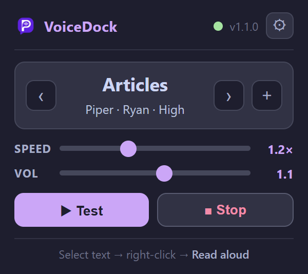
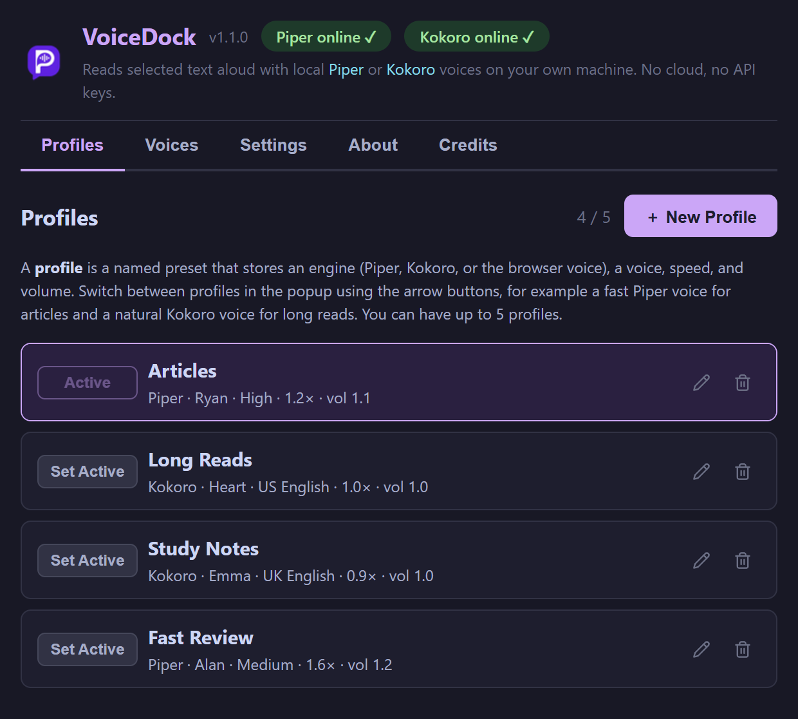
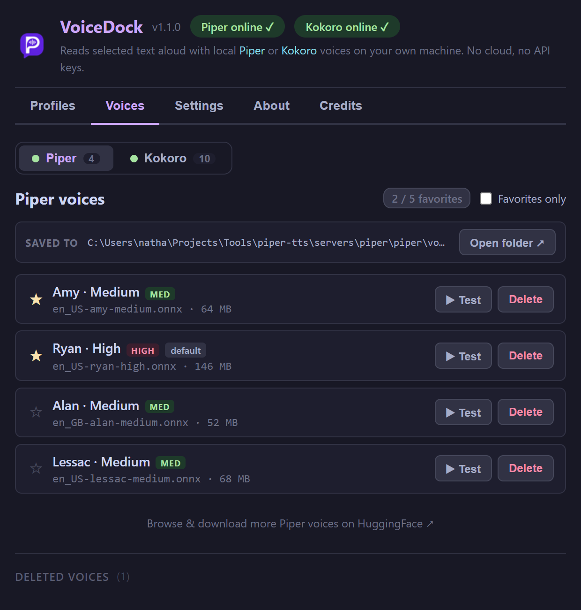
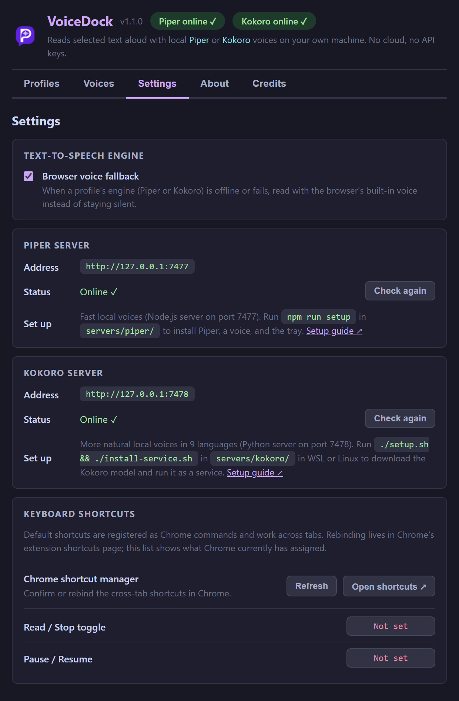
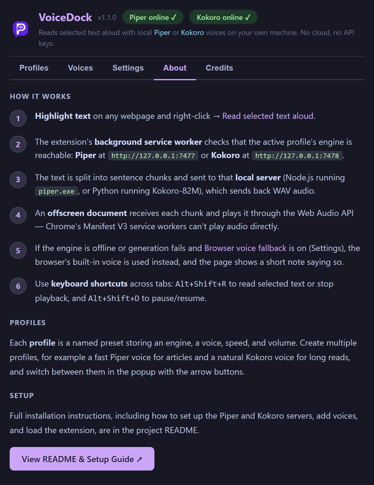
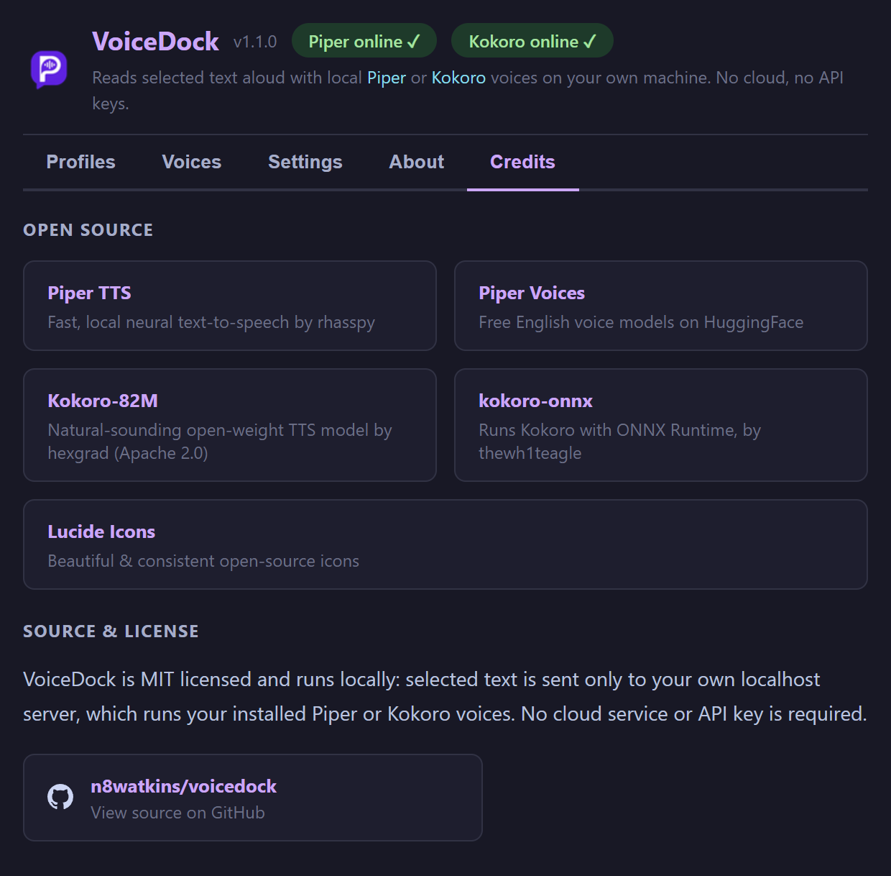

# VoiceDock

A Chrome extension that reads selected text aloud with neural voices running on your own machine.
Highlight text on any webpage, right-click it (or press `Alt+Shift+R`), and hear it read by a local engine: no cloud, no API keys, no text leaves your computer.

VoiceDock has two local engines, chosen per profile:

- **[Piper](https://github.com/rhasspy/piper)**: fast and light, with downloadable English voices (Node.js server on port 7477).
- **[Kokoro](https://huggingface.co/hexgrad/Kokoro-82M)**: more natural, 54 voices in 9 languages, slightly slower (Python server on port 7478).

The browser's built-in voice is a third choice and the automatic fallback when an engine is offline, so the extension works instantly with no server at all.

> VoiceDock was called **Piper TTS** up to version 1.0.17.
> The GitHub repo was `n8watkins/piper-tts` (the old URL redirects), and settings saved by Piper TTS carry over automatically.
> See [docs/NAMING.md](docs/NAMING.md) for the name and what a rename touches.


## Screenshots













`npm run screenshots` regenerates these from WSL with Windows Chrome and mocked servers (see `tools/capture-screenshots.mjs`).
If your Windows account, Chrome path, or Windows Node path differs from the defaults, set `PIPER_TTS_WINDOWS_USER`, `PIPER_TTS_CHROME_PATH` or `PIPER_TTS_WINDOWS_NODE`.

---

## What's in this repo

```
voicedock/                      (VoiceDock)
├── extension/                  Chrome Manifest V3 extension
│   ├── manifest.json
│   ├── background.js           Service worker: menus, shortcuts, engine choice, fallback
│   ├── offscreen.html/.js      Hidden page that fetches and plays engine audio (MV3 requirement)
│   ├── content.js              On-page overlay (progress, live speed and volume)
│   ├── src/                    React source for popup and options, plus shared.js
│   ├── dist/                   Built React bundles loaded by Chrome
│   └── popup.*, options.*, icons/
├── servers/
│   ├── piper/                  Node.js server that runs piper.exe (port 7477), plus its tray
│   └── kokoro/                 Python server that runs Kokoro-82M (port 7478), plus a systemd unit
├── docs/
│   ├── API.md                  The engine API both servers implement
│   ├── NAMING.md               The VoiceDock name, alternatives, and what a rename touches
│   └── TRAY_PLAN.md            Plan for one N8 Tray module that runs both engines
├── UPDATE_WINDOWS_SERVER.md    How to update the Piper server running on Windows
├── test/                       node --test: extension helpers, engine routing, Piper server contract
└── tools/                      esbuild, version bump, Windows deploy, screenshots, git hooks
```

`servers/kokoro` was moved in from the standalone `kokoro-tts` repo with `git subtree`, so its history is kept (see [its README](servers/kokoro/README.md#history)).

---

## Development

```bash
npm install                    # installs deps and enables the git hooks
npm ci --prefix servers/piper  # Piper server deps (its contract tests need them)
npm run build                  # bundle extension/src into extension/dist
npm test                       # extension + Piper server tests (node --test) and Kokoro server tests (python3 unittest)
npm run deploy                 # copy the built extension/ to the Windows folder Chrome loads
```

`npm run deploy` mirrors `extension/` into the Windows folder that Chrome loads unpacked.
It looks for `…/Projects/Tools/piper-tts`, then `…/voicedock`, then `…/local-tts-reader`; override with `VOICEDOCK_WINDOWS_DIR`.
An unpacked extension's ID, and so its saved settings, depends on its folder path, so keep Chrome on the folder it already loads.
It only touches `extension/`, never a server or its downloaded binaries and voices.
Reload at `chrome://extensions` afterward.

The committed `extension/dist` bundles must always match `extension/src`.
A tracked pre-commit hook (`tools/hooks/pre-commit`) rebuilds and re-stages them, and CI fails if they drift.
`npm install` enables the hook through the `prepare` script, or run `git config core.hooksPath tools/hooks`.

Commits follow Conventional Commits and releases are cut with `npm run release` (see [RELEASING.md](RELEASING.md)).
The servers are versioned separately from the extension.

---

## Setup guide

### Step 1 - Get the code

```bash
git clone https://github.com/n8watkins/voicedock.git voicedock
cd voicedock
```

### Step 2 - Load the Chrome extension

1. Open `chrome://extensions`.
2. Turn on **Developer mode** (top right).
3. Click **Load unpacked** and select the **`extension/`** folder.

The VoiceDock icon appears in the toolbar.

> **You can stop here.**
> The extension already reads with your browser's built-in voice.
> For natural local voices, set up one or both engines below.

The built React bundles are committed under `extension/dist/`, so no build step is needed just to load the extension.

### Step 3 - Set up an engine

Set up whichever engines you want; profiles that use an engine that isn't running fall back to the browser voice.

#### Piper server

The quick way, from `servers/piper/`:

```bash
npm run setup
```

It adapts to your OS: it installs dependencies, downloads the Piper binary and a default voice (`en_US-amy-medium`), starts the server, and adds a tray (green or red status dot) that starts at login.
It is idempotent, so re-run it anytime.

<details>
<summary>Manual Piper setup</summary>

1. Download the Piper build for your OS from the [Piper releases page](https://github.com/rhasspy/piper/releases/latest) (for example `piper_windows_amd64.zip`) and extract **all** of it into `servers/piper/piper/`.
   On Windows that folder holds `piper.exe`, `espeak-ng-data/` and some DLLs.
   On macOS and Linux the executable is `servers/piper/piper/piper` (or set `PIPER_BIN`).
2. Download a voice from [Piper voices on HuggingFace](https://huggingface.co/rhasspy/piper-voices/tree/main/en/en_US): both the `.onnx` model and its `.onnx.json` config (for example `en_US-ryan-high.onnx` and `en_US-ryan-high.onnx.json`), into `servers/piper/piper/voices/`.
3. Start the server:

   ```bash
   cd servers/piper
   npm ci
   npm start
   ```

   You should see `VoiceDock Piper server` and `Running at http://127.0.0.1:7477`.

Platform helpers, all from `servers/piper/`:

| Command | Does |
| --- | --- |
| `npm run start:unix` | Start on macOS or Linux. |
| `npm run start:windows` | Start in a PowerShell window. |
| `npm run start:windows:bg` / `npm run stop:windows:bg` | Start or stop a hidden background server on Windows. |
| `npm run start:windows:tray` | Start the Windows tray (status, Start, Stop, Restart, Open Voices Folder, Exit). |
| `npm run install:windows:tray` / `npm run uninstall:windows:tray` | Add or remove the tray from Windows sign-in startup. |

If another Piper server is already running, the tray shows it as external and won't stop a process it doesn't manage.

</details>

To add voices later, put each `.onnx` and `.onnx.json` pair in `servers/piper/piper/voices/` (the **Open folder** button on the Voices tab opens it), then restart the server.
Test, star, or delete voices from **Settings → Voices → Piper**.

#### Kokoro server

Kokoro runs in Linux or WSL (Python 3.10 or newer).
WSL2 mirrors `localhost` to Windows, so Chrome on Windows reaches it at `127.0.0.1:7478`.

```bash
cd servers/kokoro
./setup.sh            # venv + kokoro-onnx + the Kokoro-82M model (about 340 MB)
./install-service.sh  # systemd user service: starts at login, restarts on crash
```

Or run it in the foreground with `./start.sh`.
See [servers/kokoro/README.md](servers/kokoro/README.md) for details, logs, and the no-systemd fallback.

### Step 4 - Verify in Chrome

1. Open the extension's **Settings** tab: each engine shows **Online** or **Offline**, with a **Check again** button.
2. On **Profiles**, edit a profile and pick its **Engine** and **Voice**, then press **Test**.
3. The popup's status dot shows whether the active profile's engine is reachable.

---

## Usage

**Read text aloud:** highlight text, right-click, and choose **Read selected text aloud** (or press `Alt+Shift+R`).
Stop with `Alt+Shift+R` again, the popup's **Stop** button, or right-click → **Stop reading**.

**Keyboard shortcuts:**

- Read / stop selected text: `Alt+Shift+R`
- Pause / resume: `Alt+Shift+D`

Rebind them at `chrome://extensions/shortcuts` (the Settings tab links there).

**Profiles:** each profile stores an engine (Piper, Kokoro, or the browser voice), a voice, a speed, and a volume.
Switch profiles with the `‹` / `›` arrows in the popup, or use **Read as…** in the right-click menu.

**While reading:** the on-page overlay shows progress and lets you nudge speed and volume for the current reading without changing the profile.

---

## Settings page

| Tab | What you can do |
| --- | --- |
| **Profiles** | Create, edit, and delete up to 5 profiles, each with an engine, voice, speed, and volume. |
| **Voices** | Switch between Piper and Kokoro, test voices, and star up to 5 favorites per engine. Piper voices can be deleted from disk. |
| **Settings** | The browser voice fallback, each engine server's address and status with setup hints, and keyboard shortcuts. |
| **About** | How selected text flows through the engine servers and the offscreen player. |
| **Credits** | Piper, Kokoro, and the other open-source pieces. |

---

## Engines compared

| | Browser voice | Piper | Kokoro |
| --- | --- | --- | --- |
| Needs a local server | No | Yes (port 7477) | Yes (port 7478) |
| Sends text to a hosted API | No | No | No |
| Voices | Your OS voices | Downloaded `.onnx` voices (8 installed here) | 54 built-in voices, 9 languages |
| Sound | Robotic | Good | Most natural |
| Warm latency, one sentence (measured here) | Instant | about 1.15 s | about 1.5 s |
| Manage voices in the app | No | Install, test, favorite, delete | Test, favorite |
| Speed control | Yes | Yes, live | Yes, live |
| Volume | Up to the browser max | Up to 2× gain | Up to 2× gain |
| When the engine is down | Always available | Falls back to the browser voice (if on) | Falls back to the browser voice (if on) |

---

## How it works

```
Highlight text → right-click "Read selected text aloud" (or Alt+Shift+R)
       ↓
background.js: which engine does the active profile use?
       ↓                                   ↓
 Piper or Kokoro, server online      browser engine, or server offline
       ↓                                   ↓       (fallback on: page shows a short note)
 offscreen.js splits text into chunks    chrome.tts.speak()
       ↓
 POST /tts → 127.0.0.1:7477 (Piper) or 127.0.0.1:7478 (Kokoro)
       ↓
 WAV audio → Web Audio API, next chunk prefetched while this one plays
```

Manifest V3 service workers can't play audio, so engine audio is played by an **offscreen document**, a hidden page that can use `new Audio()`.
Both servers implement the same small API, documented in [docs/API.md](docs/API.md).

---

## Privacy and security

VoiceDock sends selected text only to servers on your own machine.
Both servers bind to `127.0.0.1` and reject requests from web pages: only requests from a Chrome extension, or with no `Origin` header at all (curl, scripts), are served.
So a site you visit can't use your local engines.

---

## Troubleshooting

**The right-click menu doesn't appear.**
Make sure the extension is loaded and enabled at `chrome://extensions`.

**An engine shows Offline.**
Piper: run `npm start` (or the tray) in `servers/piper/` and check that port 7477 is free.
Kokoro: run `systemctl --user status kokoro-tts` in WSL, or `./start.sh` in `servers/kokoro/`, and check port 7478.
Then press **Check again** on the Settings tab.

**A profile sounds like the browser voice.**
Its engine is offline and the fallback kicked in; the page shows a short note when that happens.
Start the engine, or turn the fallback off in Settings to get an error instead.

**No audio at all.**
Open DevTools (F12 → Console) on the page and look for errors.
Common causes: no Piper voice downloaded, a missing `piper.exe`, or the Kokoro model not downloaded (run `./setup.sh`).

---

## Roadmap

- [x] Browser voice (no setup)
- [x] Local Piper server, offscreen playback, sentence chunking with prefetch
- [x] Named profiles, voice management, keyboard shortcuts, on-page overlay
- [x] Windows tray and one-command Piper setup
- [x] Kokoro as a second engine, chosen per profile (1.1)
- [ ] One N8 Tray module that runs both engines ([docs/TRAY_PLAN.md](docs/TRAY_PLAN.md))
- [ ] Rename the repo and the Chrome Web Store listing ([docs/NAMING.md](docs/NAMING.md))
- [ ] macOS and Linux real-machine verification of the Piper server

---

## Credits

- [Piper](https://github.com/rhasspy/piper): fast, offline neural TTS by rhasspy, and the [Piper voices](https://huggingface.co/rhasspy/piper-voices).
- [Kokoro-82M](https://huggingface.co/hexgrad/Kokoro-82M): open-weight TTS model by hexgrad (Apache 2.0).
- [kokoro-onnx](https://github.com/thewh1teagle/kokoro-onnx): runs Kokoro with ONNX Runtime.
- Chrome Offscreen Documents API (Manifest V3).

MIT License: free to use, fork, and share.
